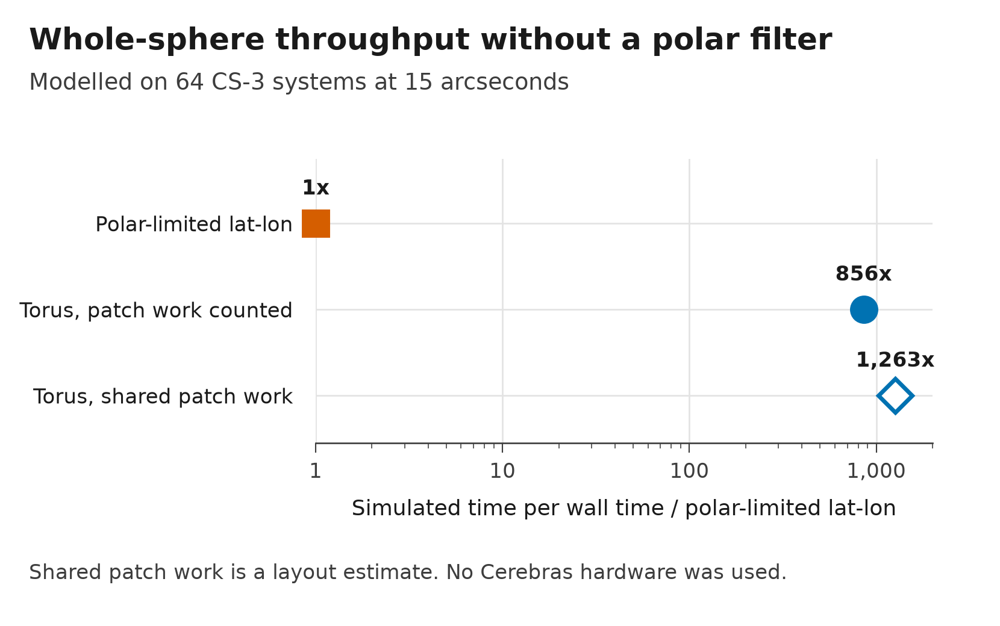
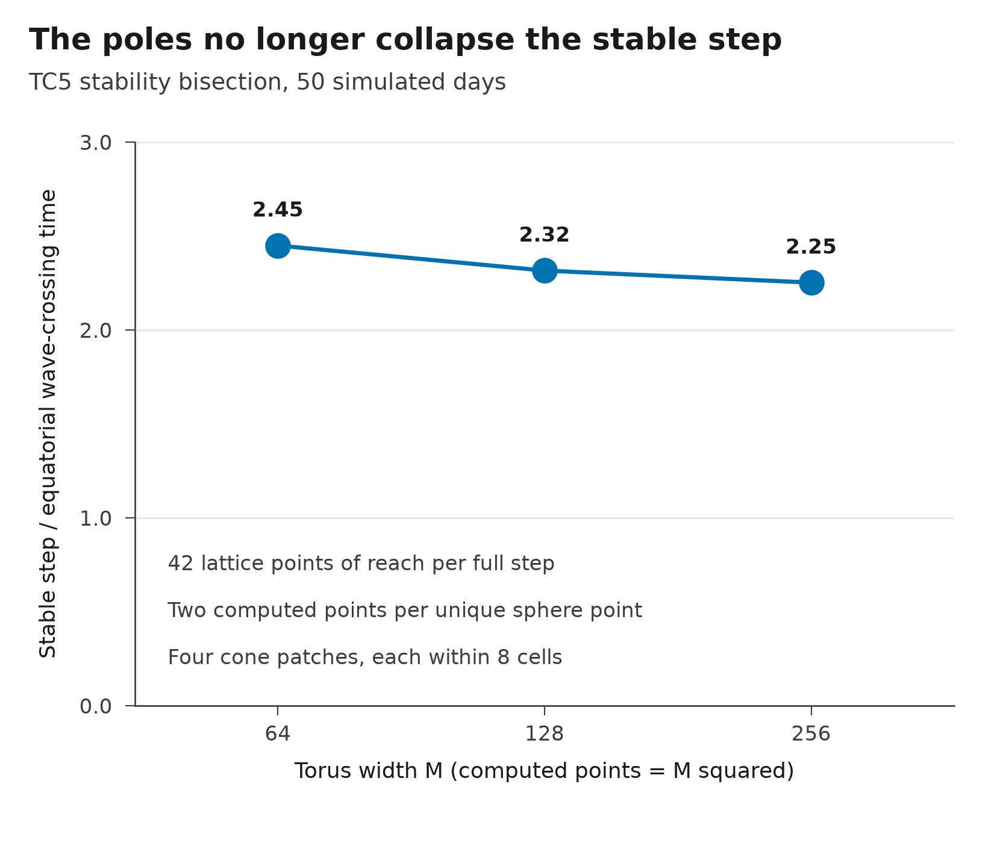
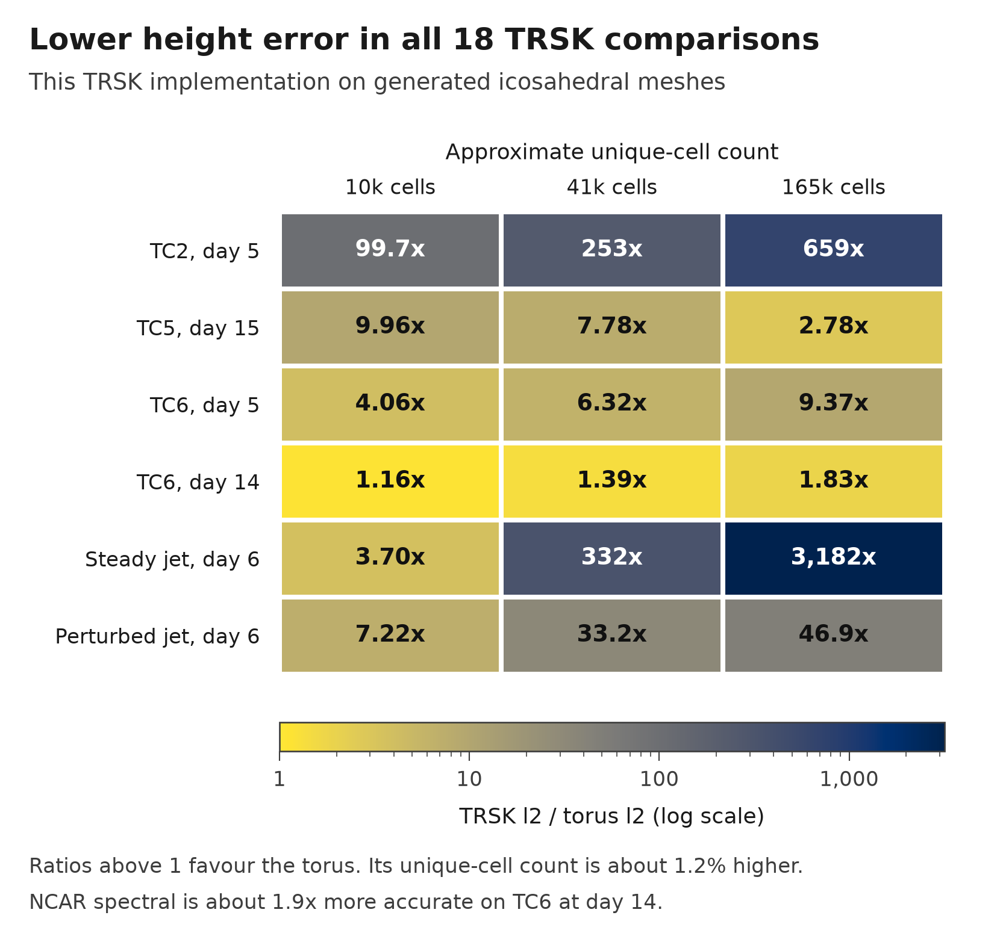
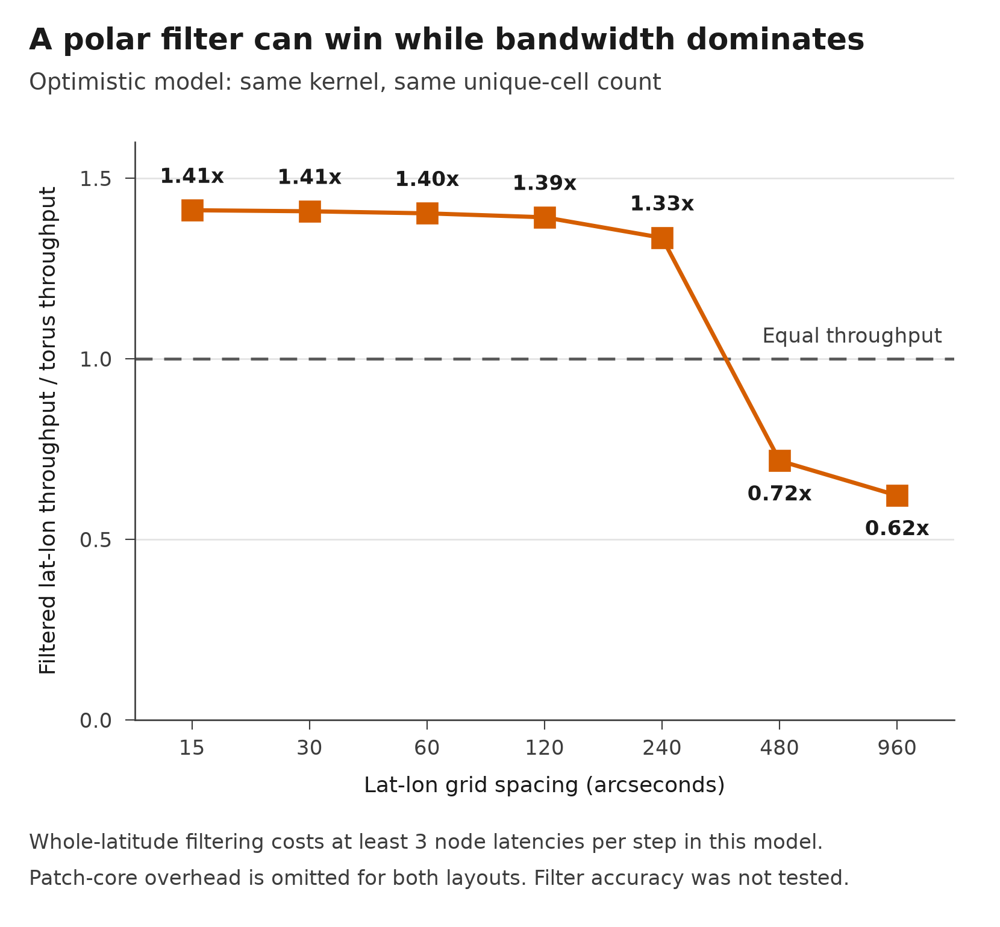

# Sphere on a torus

**A whole-sphere shallow-water solver with a fixed 42-point reach and no whole-latitude polar filter.** Its double-cover grid avoids the polar timestep collapse. At 15 arcseconds, the model gives about **856x more simulated time per wall time** than an unfiltered, polar-limited lat-lon baseline on 64 CS-3 systems, at the cost of computing two copies of each sphere point.

These are modelled speeds. No Cerebras hardware was used. The baseline extends the paper's cost model to a polar-limited whole sphere; the paper does not disclose its pole treatment.

<a href="figures/throughput.svg"></a>

Sharing cone-patch work gives the larger estimate. That schedule is not implemented. The counted model also needs a distributed coefficient layout to fit core memory. [Assumptions, traffic and memory](docs/PERFORMANCE.md) give the limits of both estimates.

## Local work, poles included

**The stable step stays bounded over the tested resolutions.** A tetrahedral double cover maps a periodic lattice onto the sphere. Four local cone patches handle the places where the two copies meet. The rest uses the same stencil everywhere. The solver uses local dissipation, which is off inside those patches.

<a href="figures/locality.svg"></a>

The two-copy cost is unavoidable for a locally oriented branched cover from a torus to a sphere. It is not a bound on every mapping with seams or moving boundaries. [The method](docs/METHOD.md) explains the scope and cone treatment.

## Accuracy at nearly equal unique-cell counts

**Lower normalised height l2 error in all 18 paired comparisons with this implementation of TRSK**, the scheme used by MPAS. The meshes are generated centroidal icosahedral meshes, not downloaded MPAS meshes. The torus has about 1.2% more unique points and computes each twice.

<a href="figures/accuracy.svg"></a>

These tests cover steady flow, a mountain, a Rossby-Haurwitz wave and two jets. Both schemes use the same references and scores. This does not compare complete atmosphere models. TRSK leads in two linf comparisons, and NCAR spectral is about 1.9x more accurate on TC6 at day 14. [Norms, reference uncertainty and other cases](docs/METHOD.md#accuracy-comparisons) keep those distinctions visible.

For TC2, perturbation-form FP32 stays within about 2.6 to 2.9e-8 of FP64 through M=2048. Its round-off overtakes TC2's truncation error at roughly M=500. [Saved measurements and provenance](data/) include the precision study and every paired score.

## When a polar filter is worth it

**An optimistic filtered lat-lon model is 1.41x faster at 15 arcseconds.** At 480 and 960 arcseconds it falls to 0.72x and 0.62x of torus throughput as latency becomes the limit.

<a href="figures/filter-trade.svg"></a>

This comparison holds the kernel and unique-cell count fixed, omits patch-core overhead, and assumes at least three node latencies for a whole-latitude filter. Its accuracy cost was not tested. It is a separate comparison from the 856x polar-limited baseline.

## How to use it

Run `./run.sh` from the repository root with Python 3.11 or newer. It creates a local environment, installs the pinned packages and runs the short checks. Then try a small whole-sphere run:

```sh
.venv/bin/python examples/steady_flow.py
```

To use your own fields, build the grid with `grid.torus_X(M)` and the main scheme with `experiments.build(X, case, configs.MAIN)`. [The porting guide](docs/PORT.md) gives array meanings, the local update and what a machine implementation must carry. This release supplies a CPU solver, an optional GPU arithmetic path and a hardware dataflow model. It does not supply Cerebras kernels.

Anyone may use the independent solver, generated data, figures and text freely, including commercially, under [CC0 1.0](LICENSE). NCAR reference software is fetched separately under its own [research and education terms](docs/THIRD_PARTY.md). [Reproduction checks](docs/REPRODUCE.md) cover the saved numbers, the figure data and the cluster stages needed to rerun the numerical study.
