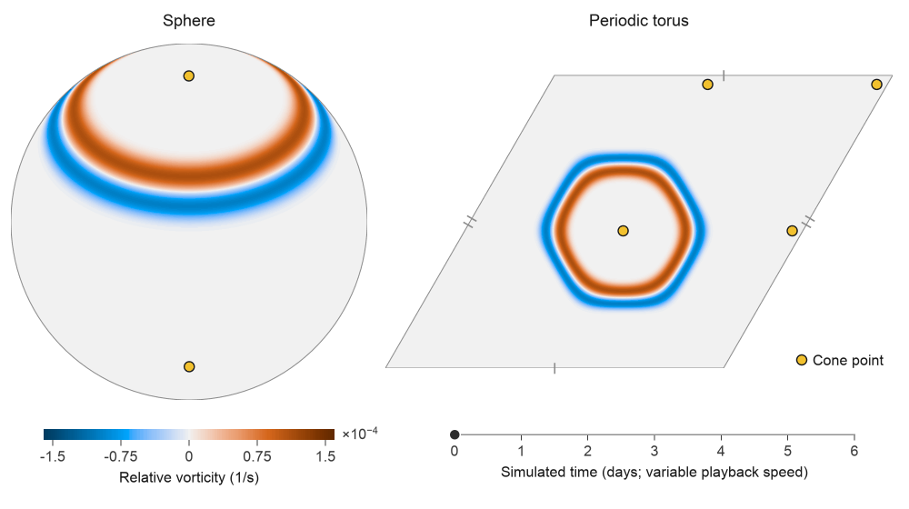
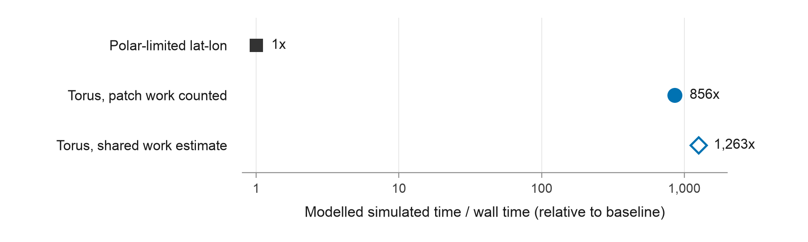
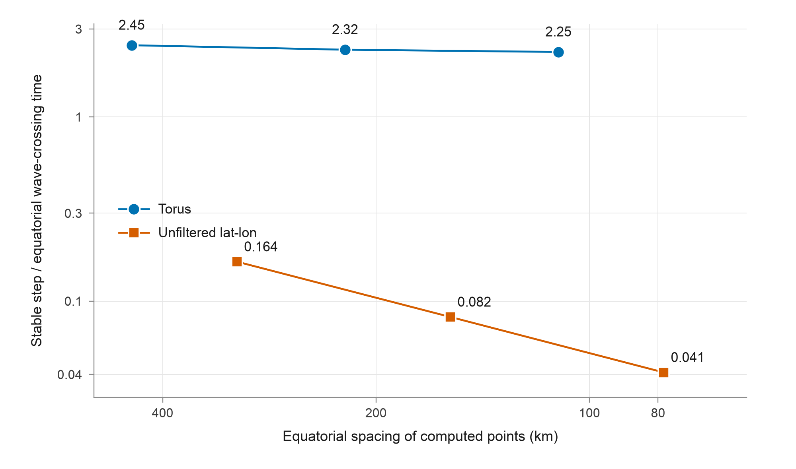
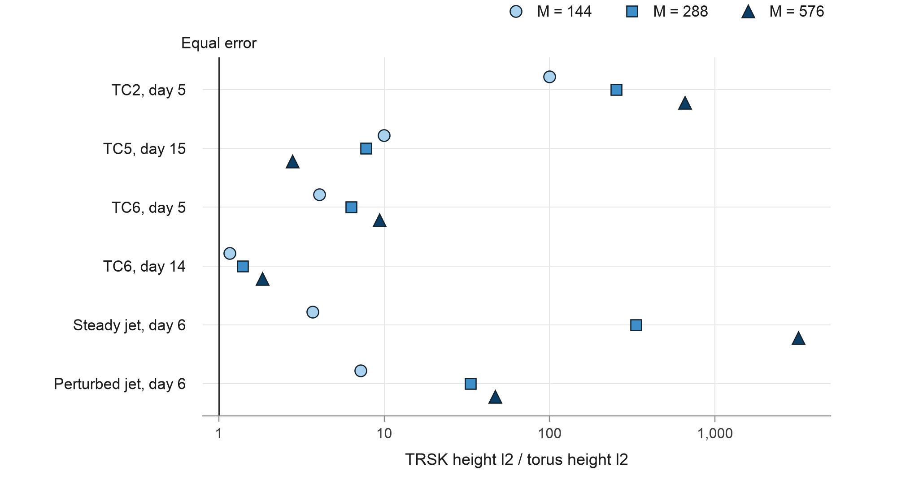
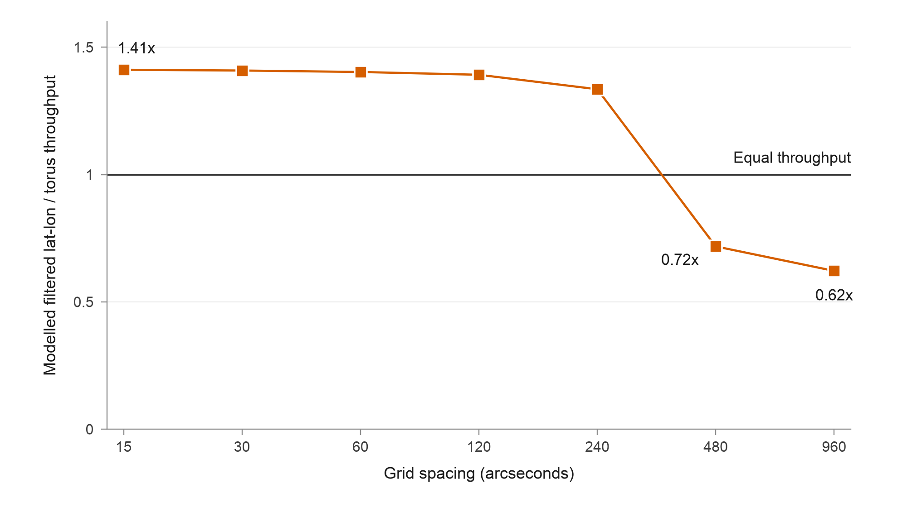

# Sphere on a torus

Global weather models must move fluid across the poles, where a latitude-longitude grid crowds points together and forces tiny time steps. `polarswe` solves the shallow-water equations on a periodic torus mapped twice onto the sphere, keeping a fixed 42-point reach everywhere. On 64 Cerebras CS-3 systems at 15 arcseconds (463 m), the Domain Translation cost model estimates **856x more simulated time per wall time** than an unfiltered, polar-limited grid, with no Cerebras hardware measurements.

Six simulated days of the Galewsky jet at M = 512, shown on the sphere and its periodic torus grid. Colour shows relative vorticity on a fixed scale; dots mark the cone points, all four visible on the torus.

## What avoiding the poles buys

The torus takes fewer steps per second, but each step advances much more simulated time. The **856x model estimate** counts cone-patch work on the busiest core; sharing it gives a **1,263x estimate with an unimplemented schedule**.

Modelled throughput at 15 arcseconds on 64 CS-3 systems, using extrapolated time steps. Both torus estimates need a new coefficient layout: the busiest core needs about 70.5 kB against an assumed 48 kB.

Torus limits are 2.45, 2.32 and 2.25 equatorial wave-crossing times at M = 64, 128 and 256, tested over 50 simulated days. The unfiltered second-order latitude-longitude tests cover 5, 3 and 1 simulated days respectively; both sets use bisection to 2%.

[Method and cone operators](docs/METHOD.md). [Stability definitions and throughput assumptions](docs/PERFORMANCE.md).

## Lower height error in all 18 TRSK comparisons

At nearly equal unique-cell counts, the torus has lower normalised height $`l_2`$ error in **all 18 paired comparisons** with the supplied TRSK implementation on generated MPAS-type meshes. It uses about 1.2% more unique points and computes each twice.

Each point compares the same test and reference at one of three resolution pairs; values above one favour the torus. The finest mountain test approaches the reference's own uncertainty.

TRSK has lower maximum error in two comparisons. NCAR's spectral model has about **1.9x lower TC6 day-14 $`l_2`$ error** at matched point counts. These are shallow-water tests, not full atmosphere models. [Norms, reference uncertainty and comparison limits](docs/METHOD.md#accuracy-comparisons).

## A polar filter can be faster

In a separate model with the same kernel and unique-point count, filtered latitude-longitude is **1.41x as fast at 15 arcseconds**, but only 0.72x and 0.62x as fast at 480 and 960 arcseconds.

The model favours one copy at fine spacing and local communication at coarse spacing. It omits cone-patch overhead, charges at least three CS-3 system latencies per filter step and does not test the filter's accuracy cost.

## Assumptions made

- The throughput model extends Domain Translation from [Oppelstrup et al., arXiv:2511.11542](https://arxiv.org/abs/2511.11542), whose pole treatment is undisclosed. The 15-arcsecond case was not simulated: the torus step is extrapolated from M = 256, and the polar limit from a second-order centred/RK4 solver, not the paper's Lax-Wendroff solver.
- Both throughput estimates require coefficient distribution or streaming. Neither a Cerebras kernel nor the proposed sharing schedule has been implemented or timed.
- Equal unique-cell counts do not mean equal work, storage or degrees of freedom. The accuracy comparisons establish neither forecast quality nor speed at equal accuracy.
- The filtered comparison has a different baseline and cannot be combined with the 856x estimate.
- Fine grid-scale stripes in the movie's late vorticity bands are in the saved field. The movie shows the computed flow, not convergence of its smallest structures. [Reading the movie](docs/METHOD.md#reading-the-movie).

## How to use it

[Install and check the numbers](REPRODUCE.md), try [steady flow](examples/steady_flow.py), or load the [comparison data](data/README.md). The package includes a CPU solver, optional GPU arithmetic and a dataflow model; the [porting guide](docs/PORT.md) gives the field interface and the unresolved hardware requirements.

The code, generated data, figures and text are [CC0 1.0](LICENSE). NCAR reference software is fetched separately under [research and education terms](THIRD_PARTY.md).
